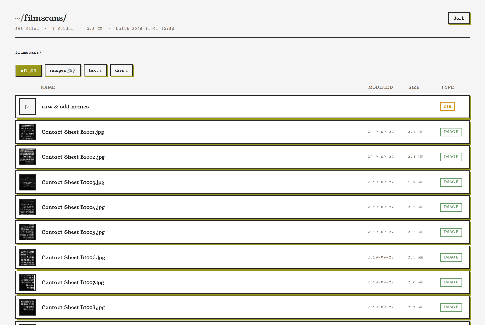
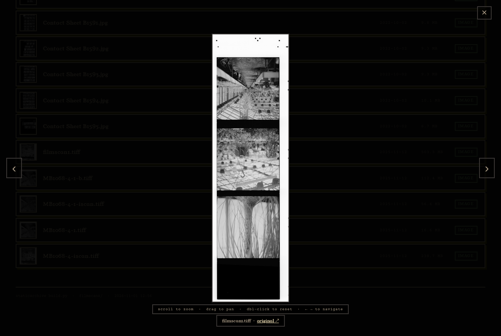

# staticarchive

One Python script that makes a folder of files browsable in a web browser. It writes a plain
`index.html` into every folder, with thumbnails, a zoomable image viewer, type filters and a light/dark
theme. You don't need a database, a server or an account. The pages open from a web server, a NAS
share, a USB drive or straight from disk.

It's made for archives: thousands of scans, RAW files and TIFFs that would otherwise only be
browsable in a file manager.





## Use it

Download [`build.py`](build.py), then:

```bash
python3 build.py /path/to/archive           # build every folder under it
python3 build.py /path/to/archive --serve   # build, then browse at http://localhost:8080
python3 build.py --help                     # all options
```

Run it again whenever files change. Only new or changed images are processed, so re-runs are fast.

## What you need

- **Python 3.9+.** Nothing to install from pip.
- **Optional but recommended:** [libvips](https://www.libvips.org/) (`vipsthumbnail`), or
  ImageMagick as a slower fallback. With one installed, you also get:
  - small thumbnails instead of loading every full-size original
  - viewable previews of **TIFF, camera RAW (CR2, CR3, NEF, ARW, RAF, DNG…) and HEIC**

  Without either, rows show the original images and TIFF/RAW files get an icon.

  ```bash
  sudo pacman -S libvips    # Arch
  sudo apt install libvips-tools    # Debian/Ubuntu
  brew install vips         # macOS
  ```

## What it writes

- An `index.html` in every folder. If a folder already has an `index.html` this script didn't make,
  it's left alone (`--force` overwrites it).
- A `_thumbs/` folder at the top with JPEG thumbnails and previews. Delete it any time. It's rebuilt
  on the next run.

Your original files are never changed.

## Limits

- Very large folders (tens of thousands of files in *one* folder) make a long page. It works, but
  is slow to open.
- Video and audio are listed and linked but not previewed.
- Fonts load from Google Fonts. Offline, the pages fall back to Georgia and Courier.

## Licence

`build.py` is free software under the [GNU GPL v3 or later](LICENSE). You can use it for
anything, including paid work. If you share a modified version, share its source under the same
licence.

**The pages it generates are yours.** They're not covered by the GPL, even though they contain
the script's CSS and JavaScript, so you can publish them under any terms you like. The exact
wording is at the top of `build.py`.
